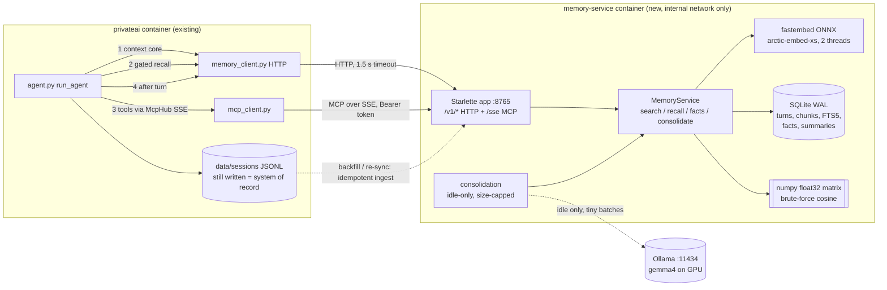

# PrivateAI memory service — design, prototype and measurements

Status: **design + working prototype** (merged into `main`; code in [`memory-service/`](../memory-service/); the pre-merge state is tagged `pre-memory-service`).
Bot-side integration (§11) is implemented behind flags on `main` and runs in **shadow mode** (dual-write + logged recall, nothing injected, tools hidden); see the top-level README "Memory service (shadow mode)".

Legend used throughout: **[M]** = measured on pai01 during this work, **[E]** = estimate / extrapolation, **[D]** = design decision / assumption.

---

## 1. Problem statement and measurements of the current system

The bot keeps memory in three places (all read from `src/memory.py`, `src/rag.py`, `src/agent.py`):

| Mechanism | What it does | Problem |
|---|---|---|
| Rolling summary (`<id>.summary.json`) | After each turn a background task summarises the oldest 12 unsummarised records into **one** blob, merged with the previous blob | Lossy and compounding; competes with chat for the single Ollama slot; uncapped batch (12 × 4,000 chars) can overflow `num_ctx=8192` |
| Last 8 records | Injected verbatim every turn (≤12,000-char budget) | Fixed cost on every request |
| RAG (`RagStore`) | nomic-embed-text through Ollama, top-4 chunks ≤4,000 chars, min score 0.25, **injected on every request** | Fixed cost on every request; embeddings stored as JSON text; needs a second model resident in Ollama |

Measurements on the real backup (the main chat’s `<id>.jsonl` + `.summary.json`, read from a private copy):

| Fact | Value |
|---|---|
| Transcript size **[M]** | 228 records (114 user / 114 assistant), 175,039 chars total, 17 distinct days (2026-08-04 … 2026-11-11); median record 184 chars, p90 2,492, max 4,463 |
| Second session (Session.js id) **[M]** | 28 records, 13,414 chars |
| Rolling summary **[M]** | 2,266 chars summarising 216 messages / 167,196 chars → **74 : 1** compression. Of 12 questions I wrote from the transcript, the summary contains a regex-relevant answer for only **4/12** (and one of those is incidental); e.g. nothing about the car, the VRAM limit, MCP or the user’s job. Regex proxy, so treat as an upper bound on recall. |
| Legacy summarisation batch **[M]** | Actual sequential batches: max 15,995 chars (~4k tokens), mean 9,262. Worst sliding window of 12 records: 17,026 chars. Theoretical maximum 48,000 chars (≈12k tokens) + 6,000-char prior summary → can exceed the 8,192-token context (has not happened in this data, but nothing prevents it). |
| Legacy RAG store **[M]** | 351 chunks, 175,476 chars (i.e. a re-chunked copy of the transcript), 4.3 MB of which 3.6 MB is 768-d embeddings stored as JSON text. `nomic-embed-text` is resident in Ollama (376 MB, CPU, “Forever”). RAG adds nothing that the transcript does not already contain, so the service does **not** ingest `data/rag`; it re-indexes from transcripts. |
| Legacy prompt for a trivial message **[M]** | system + summary (2,266) + RAG block (810, one sample query; 5 sample queries gave 310–2,245 chars) + last 8 records (4,599) = **8,163 chars = 1,797 prompt tokens = 10.8 s** of prompt processing (167 tok/s) before the model starts answering |
| Chat noise **[M]** | 24 of 114 user messages (21%) are `continue` / `retry` / `are you there`; 14 mention truncation/timeouts; 5 user messages are immediate verbatim repeats (retries). These pollute the rolling summary and RAG alike; the service archives them (immutable) but search collapses exact duplicate texts. |

Conclusion: the system pays ~1.8k prompt tokens (~11 s) per turn for memory that is both too much (when irrelevant) and too little (when a specific old detail is needed).

## 2. Goals and non-goals

Goals: (1) near-total recall on demand (any past turn retrievable), (2) tiny default prompt, (3) no extra load on the GPU/Ollama slot, small RAM, (4) loss-free (raw archive is immutable; summaries are derived), (5) reachable from the bot’s `mcp==1.3.0` client, (6) bot keeps working if the service is down.

Non-goals (prototype): multi-user isolation, LLM-quality fact extraction, cross-language embedding quality, reranking models, encryption at rest.

## 3. Architecture



One Python process (uvicorn) serves the HTTP API and MCP-over-SSE and owns the single in-process embedder. The service never calls Ollama except for optional idle-time consolidation.

### 3.1 Key decisions and why

**Transport = MCP over SSE on an internal Docker network (plus a plain HTTP API for the non-tool paths).**
* `McpHub` today supports stdio servers only (`StdioServerParameters`, `stdio_client`). The `mcp==1.3.0` client package contains exactly `session`, `sse` and `stdio` modules **[M: listed from the bot image]** — no streamable-HTTP (that arrived in later releases). So SSE is the only network transport the *unchanged* client library can speak.
* stdio was rejected for the separate container: it would need `docker exec -i` from inside the bot container (docker socket = root on the host) or the whole embedder inside the bot image/process (heavier bot image, model reload on every bot restart, shared fate). It remains **plan B** (`python -m memory_service mcp-stdio` works) if SSE ever misbehaves.
* Server library: pinned to **`mcp==1.3.0`** too, so client and server are byte-for-byte the combination under test. 1.3.0 requires an era-appropriate stack (pydantic 2.11 — the same pin as the bot — starlette 0.46, sse-starlette 2.3); newer pydantic breaks `mcp.server.fastmcp` at import **[M]**. FastMCP 1.3.0 has no `sse_app()`, so `memory_service/mcp_server.py` mounts the same `SseServerTransport` objects FastMCP uses into one Starlette app (shared with the HTTP API and the auth middleware).
* Verified: the bot’s real `src.mcp_client.McpHub` + `mcp 1.3.0` client talks to the service container over SSE (tool list, 5 tool calls, bad args, **idle > 300 s** — the client’s `sse_read_timeout` — and a **service restart**). See §12.

**Embedding model = `snowflake/snowflake-arctic-embed-xs` (fastembed/ONNX, 384-d).** Seven models (including `granite-embedding-small-english-r2`) were compared on the real data with the same harness (table in §10.3). Quality of the small models is statistically indistinguishable at this corpus size (n=100 per query type, ±0.04), so the decision is on footprint: arctic-xs has the best hybrid and vector MRR among the 384-d models in the automatic evaluation, ties on the hand-written queries, ingests at ~51 chunks/s (2.3× `bge-small`), has the lowest query latency after MiniLM (p50 4.8 ms) and a 220 MB loaded RSS vs 267 MB for `bge-small`. `all-MiniLM-L6-v2` is fastest but consistently the weakest; the 768-d models (`bge-base`, `nomic-v1.5-Q`) ingest 3–7× slower and peak at 1.2–2.3× the RAM of the 384-d ones for no gain beyond noise here (`bge-base` is +0.01 hybrid MRR). `bge-small-en-v1.5` (fastembed ships its int8-quantised build) is the safe alternative: set `EMBED_MODEL` + `docker build --build-arg EMBED_MODEL=...` + `memory_service reembed`. The service refuses to start on a DB built with a different model.

**Retrieval = hybrid FTS5 + vector with reciprocal-rank fusion (equal weights, k=60), mild recency boost, per-turn collapse.** I grid-searched RRF `k` and keyword weight against my automatic queries; the “best” settings favoured keyword-biased queries and *lost* on the hand-written natural-language queries (P@3 0.72 vs 0.81 for arctic-xs), so the plain defaults were kept (no tuning against a self-generated benchmark).

**Storage = one SQLite file (WAL), vectors as float32 BLOBs mirrored in a numpy matrix.** 50k chunks = 77 MB matrix and a 2.6 ms full scan; 250k chunks = 384 MB / 14 ms **[M]** (random unit vectors). No native extensions (`sqlite-vec` avoided).

**The bot keeps writing its JSONL transcript** (dual-write during rollout and afterwards). JSONL stays the system of record; ingestion is idempotent (SHA per turn), so a service outage or a lost DB is healed by re-running `ingest`.

## 4. Storage schema (DDL)

```sql
CREATE TABLE IF NOT EXISTS meta (key TEXT PRIMARY KEY, value TEXT NOT NULL);

-- Immutable raw archive: one row per message ("turn"). Never updated or deleted
-- (triggers enforce it; purge_turns() is the audited escape hatch).
CREATE TABLE IF NOT EXISTS turns (
    id         INTEGER PRIMARY KEY AUTOINCREMENT,      -- the public "turn id" (t<id>)
    session_id TEXT    NOT NULL,
    seq        INTEGER NOT NULL,                       -- order within the session
    ts         TEXT    NOT NULL,                       -- ISO-8601 UTC
    ts_epoch   REAL    NOT NULL,
    day        TEXT    NOT NULL,                       -- YYYY-MM-DD (UTC)
    role       TEXT    NOT NULL CHECK (role IN ('user','assistant','system','tool')),
    content    TEXT    NOT NULL,                       -- secrets already redacted
    sha        TEXT    NOT NULL,                       -- sha256(ts|role|content): idempotent ingest
    redactions INTEGER NOT NULL DEFAULT 0,
    source     TEXT    NOT NULL DEFAULT 'bot',
    UNIQUE (session_id, sha)
);
CREATE INDEX IF NOT EXISTS turns_session_seq ON turns (session_id, seq);
CREATE INDEX IF NOT EXISTS turns_day ON turns (day);
CREATE INDEX IF NOT EXISTS turns_ts ON turns (ts_epoch);

CREATE TRIGGER IF NOT EXISTS turns_no_update BEFORE UPDATE ON turns
BEGIN SELECT RAISE(ABORT, 'turns are immutable'); END;
CREATE TRIGGER IF NOT EXISTS turns_no_delete BEFORE DELETE ON turns
BEGIN SELECT RAISE(ABORT, 'turns are immutable'); END;

-- Retrieval units: a turn is split into >=1 chunks; each chunk has a float32 embedding.
CREATE TABLE IF NOT EXISTS chunks (
    id         INTEGER PRIMARY KEY AUTOINCREMENT,
    turn_id    INTEGER NOT NULL REFERENCES turns(id),
    idx        INTEGER NOT NULL,
    text       TEXT    NOT NULL,
    emb        BLOB    NOT NULL,                       -- dim * 4 bytes, L2-normalised
    session_id TEXT    NOT NULL,
    role       TEXT    NOT NULL,
    ts_epoch   REAL    NOT NULL,
    UNIQUE (turn_id, idx)
);
CREATE INDEX IF NOT EXISTS chunks_turn ON chunks (turn_id);

-- Keyword index (external-content FTS5, porter stemming).
CREATE VIRTUAL TABLE IF NOT EXISTS chunks_fts USING fts5(
    text, content='chunks', content_rowid='id', tokenize='porter unicode61'
);
CREATE TRIGGER IF NOT EXISTS chunks_ai AFTER INSERT ON chunks BEGIN
    INSERT INTO chunks_fts(rowid, text) VALUES (new.id, new.text);
END;
CREATE TRIGGER IF NOT EXISTS chunks_ad AFTER DELETE ON chunks BEGIN
    INSERT INTO chunks_fts(chunks_fts, rowid, text) VALUES ('delete', old.id, old.text);
END;

-- Curated durable facts (mutable, versioned by supersession; nothing is deleted).
CREATE TABLE IF NOT EXISTS facts (
    id              INTEGER PRIMARY KEY AUTOINCREMENT,
    category        TEXT    NOT NULL,                  -- profile|preference|decision|task|note
    statement       TEXT    NOT NULL,
    norm            TEXT    NOT NULL,                  -- lower-cased, whitespace-collapsed
    emb             BLOB,
    confidence      REAL    NOT NULL DEFAULT 1.0,
    status          TEXT    NOT NULL DEFAULT 'active'  -- active|superseded|retracted
                    CHECK (status IN ('active','superseded','retracted')),
    superseded_by   INTEGER REFERENCES facts(id),
    source_turn_ids TEXT    NOT NULL DEFAULT '[]',     -- JSON array of turn ids
    session_id      TEXT,
    created_at      TEXT    NOT NULL,
    updated_at      TEXT    NOT NULL
);
CREATE INDEX IF NOT EXISTS facts_cat_status ON facts (category, status);

-- Hierarchical dated summaries: day -> week (-> month). Derived data, always
-- rebuildable from `turns`; input_sha detects stale summaries.
CREATE TABLE IF NOT EXISTS summaries (
    id            INTEGER PRIMARY KEY AUTOINCREMENT,
    level         TEXT    NOT NULL CHECK (level IN ('day','week','month')),
    period        TEXT    NOT NULL,                    -- 2026-08-04 | 2026-W32 | 2026-08
    session_id    TEXT    NOT NULL,
    text          TEXT    NOT NULL,
    emb           BLOB,
    first_turn_id INTEGER,
    last_turn_id  INTEGER,
    n_turns       INTEGER NOT NULL DEFAULT 0,
    input_sha     TEXT    NOT NULL,
    model         TEXT    NOT NULL,
    created_at    TEXT    NOT NULL,
    updated_at    TEXT    NOT NULL,
    UNIQUE (level, period, session_id)
);
```

Notes
* `turns` is the **immutable raw archive**: triggers abort UPDATE/DELETE; `purge_turns()` (CLI `purge`) is the only, audited escape hatch (drops derived rows, stamps `meta.last_purge`). A “turn id” is the public id `t<id>`; `seq` gives order within a session.
* `chunks`: one chunk per message ≤ 700 chars (median message is 184 chars, so most messages are exactly one chunk). Longer messages are split on paragraph → line → sentence boundaries, fenced code blocks kept atomic, no overlap (hits link back to the whole turn via `get_conversation`).
* `facts`: never deleted, only `superseded`/`retracted`. `summaries.input_sha` marks a summary stale when its source turns/day-summaries change.
* Embeddings: 384 × 4 B = 1,536 B per chunk. Measured DB size: **1.88 MB for 256 turns / 491 chunks** (3.8 KB per chunk incl. FTS, text and vectors) **[M]**; ≈ 40 MB per 10k chunks **[E]**. At the current rate (~228 records in 3.5 months) the DB stays in the single-digit MB for years.

## 5. Retrieval algorithm (`MemoryService.search_chunks`)

1. Parse `since`/`until` (`YYYY-MM-DD`, ISO datetime, or relative `7d`/`2w`/`1m`; a bare date as `until` includes that whole day).
2. **Vector leg:** embed the query once (with the model’s query prefix) → `matrix @ q` over masked rows (date / session / excluded turn ids) → top 50 chunks (≈4 ms server-side for the whole request incl. embedding).
3. **Keyword leg:** tokens minus a stop-word list → `"t1" OR "t2" …` FTS5 MATCH (porter stemming) with the same filters, ranked by `bm25` → top 50.
4. **RRF:** `score = Σ weight / (60 + rank)` over both legs (equal weights).
5. **Recency:** `score *= 1 + 0.15·exp(−age_days/45)` (gentle; ties go to newer; disabled for the evaluation numbers unless stated).
6. **Collapse** to the best chunk per turn, drop exact-duplicate texts (retries), take top *k* (≤10).
7. **Format** with hard caps (§7). `search` additionally prepends ≤2 matching **facts** and ≤1 matching **summary** (cosine ≥ 0.55) when no date filter is given.

Server-side (not model-visible) extras: `vec_cos` of the best hit is returned to the gate; `exclude_turns` removes the turns already present in the prompt.

## 6. Hybrid injection policy for the bot

1. **Tiny always-on core** (`GET /v1/core?session=…` or built locally): system prompt + **fact profile** (≤600 chars, active facts ordered profile → preference → decision → task → note) + **last 4 records** (2 exchanges, ≤2,400 chars total). Measured prompt for this “core only” turn: **392 tokens / 2.6 s** (vs 1,797 / 10.8 s legacy) **[M]**.
2. **Server-side gate for auto-injection** (`POST /v1/recall {query, session, exclude_recent:8, max_hits:2}`): returns ≤2 compact hits (≤700 chars) **only if** the gate fires; otherwise `inject:false` and empty text. The bot inserts the text as one system message (“Possibly relevant earlier conversation: …”) before the recent turns.
3. **Explicit tools** for deeper lookups: `search_memory`, `get_conversation`, `remember_fact`, `list_facts`, `memory_stats` (1,516 chars of schema ≈ 295 tokens ≈ 2 s of prompt processing **[M]**).

### Making the gate cheap (no LLM call)
Everything is computed inside the service in ~5 ms **[M: p50 5.3 ms, p95 15.8 ms for 108 replayed messages]**:
* **Cue regex** (`gate.refers_to_past`): explicit references to earlier conversation (“do you remember…”, “earlier”, “last time”, “we decided”, “you said/told me”, “N days ago”, “history of our…”). First-person narration (“I decided to…”) and imperatives (“remember to…”) are deliberately *not* cues (tested).
* **Top vector cosine** of the message against the archive (the same embedding the search needs anyway; archive excludes the last 8 turns).
* Fire if `cue ∧ cos ≥ 0.50` **or** `cos ≥ 0.85`.

### What the real data says about the gate **[M]**
* Replaying the 108 user messages (from message 20 on) against the history that preceded each: the **cue fires on 6/108 (5.6%)**; the strong-cosine path at 0.85/0.90 fires on ~0–2%. At 0.72 it would fire on **33%** and at 0.80 on 10% — in a chat that is mostly about a few long-running topics, absolute cosine is a **weak** discriminator (p10/p50/p90 of top cosine = 0.58/0.69/0.78). So the shipped default is *cue-first with a high strong-match threshold*; the cosine thresholds are model- and corpus-specific and must be re-calibrated (`eval/gate_eval.py`) if the model changes.
* On 5 probe questions: gate fired for the two with explicit cues (“Earlier I told you…”, “Do you remember… as we discussed before?”), not for the control (“capital of France”, cos 0.58), and not for two *implicit* recalls (“What instrument did I decide to learn?”, “…the problem with my car?”, cos 0.66–0.68). Implicit recall therefore depends on the model calling the tool or on the facts profile (§14).
* Recommended rollout: run the gate in **shadow mode** (compute and log `inject`, don’t inject) for a week, then tune.

## 7. Tool API (MCP over SSE, also usable via HTTP)

Server name in `mcp.json`: `memory` → the bot’s qualified names are `memory_search_memory`, `memory_get_conversation`, … (`McpHub._sanitize_name`). Schemas below are the exact JSON the bot sent to Ollama in the integration check (after its own description trimming; **1,516 chars total** for all five tools; budget < 2,000 **[M]**):

```json
[
 {"type":"function","function":{"name":"memory_search_memory","description":"Search past conversations (keyword+semantic). Returns dated snippets with turn ids.","parameters":{"properties":{"query":{"type":"string"},"k":{"default":5,"type":"integer"},"since":{"default":"","type":"string"},"until":{"default":"","type":"string"},"session":{"default":"","type":"string"}},"required":["query"],"type":"object"}}},
 {"type":"function","function":{"name":"memory_get_conversation","description":"Show the conversation around a turn id (t123) or on a date, with day summary.","parameters":{"properties":{"around_turn_id":{"default":0,"type":"integer"},"date":{"default":"","type":"string"},"window":{"default":3,"type":"integer"}},"type":"object"}}},
 {"type":"function","function":{"name":"memory_remember_fact","description":"Save a durable fact/preference/decision/task about the user for future chats.","parameters":{"properties":{"statement":{"type":"string"},"category":{"default":"note","type":"string"}},"required":["statement"],"type":"object"}}},
 {"type":"function","function":{"name":"memory_list_facts","description":"List saved durable facts, newest first.","parameters":{"properties":{"category":{"default":"","type":"string"}},"type":"object"}}},
 {"type":"function","function":{"name":"memory_memory_stats","description":"Memory size/coverage summary.","parameters":{"properties":{},"type":"object"}}}
]
```

### Output formats and budgets
All outputs are plain text, newline-separated, hard-capped server-side (env-tunable). 4 chars ≈ 1 token (measured 4.0–4.5 chars/token on gemma4 **[M]**).

| Tool | Cap | Format |
|---|---|---|
| `search_memory` | 1,800 chars (≈450 tok), ≤10 hits, snippet ≤420 chars each | `[fact#12 preference] …` (≤2) · `[day summary 2026-03-02] …` (≤1) · `[t<turnid> <date> <role>] <snippet>` per hit, best first; `(+N more omitted; refine query)`; `No matching memory.` |
| `get_conversation` | 3,000 chars; focus turn ≤900 chars, others share the rest | `[day summary <date>] …` then `[t<id> <YYYY-MM-DDTHH:MM> <role>] <text>` in order; `(+N more turns; …)` |
| `remember_fact` | statement ≤500 chars | `saved fact#N` · `saved fact#N (replaces fact#M)` · `already known: fact#N` |
| `list_facts` | 1,500 chars | `fact#N [category] statement (date)` newest first |
| `memory_stats` | one line | `turns=… chunks=… sessions=… days=… facts=… summaries=… range=…..… model=… db=…KB` |
| `recall` (HTTP only) | 700 chars, ≤2 hits | `[t<id> <date> <role>] <snippet>` lines or empty |

Examples (synthetic data, real embedder; outputs copied from a run):

```text
search_memory(query="which database did we pick for the inventory app", k=3)
[t11 2026-03-11 user] The inventory app needs an index on products.sku for fast lookups.
[t10 2026-03-10 assistant] Agreed: PostgreSQL 16 for the inventory app. I will draft the schema with a products table.
[t9 2026-03-10 user] Let's decide: we will use PostgreSQL 16 for the inventory app, not MySQL.

get_conversation(around_turn_id=9, window=1)
[t8 2026-03-03T09:07 assistant] Run certbot renew, then reload nginx; grafana sits behind the nginx proxy on port 3000.
[t9 2026-03-10T09:08 user] Let's decide: we will use PostgreSQL 16 for the inventory app, not MySQL.
[t10 2026-03-10T09:09 assistant] Agreed: PostgreSQL 16 for the inventory app. I will draft the schema with a products table.

remember_fact(statement="User prefers PostgreSQL over MySQL for new projects", category="preference")
saved fact#1
(second call with a near-identical statement)  ->  already known: fact#1

memory_stats()
turns=14 chunks=14 sessions=1 days=5 facts=1 summaries=0 range=2026-03-02..2026-03-17 model=snowflake/snowflake-arctic-embed-xs db=0KB
```

Fact semantics: same category and cosine ≥ 0.97 → dedupe (touch `updated_at`); cosine ≥ 0.85 → the new fact **supersedes** the old one (old row kept, `superseded_by` set); thresholds are configurable and need tuning with the chosen model (open question). Statements are passed through the secret redactor.

### HTTP API (same process, `Authorization: Bearer <token>` when `AUTH_TOKEN` is set; `/healthz` open)
`POST /v1/search` `{query,k,since,until,session,mode}` · `POST /v1/recall` · `POST /v1/turns` `{session_id, turns:[{role,content,timestamp?}]}` · `GET /v1/core?session=&turns=` · `POST /v1/conversation` · `GET|POST /v1/facts` · `GET /v1/stats` · `GET /healthz`.

## 8. Ingestion and backfill

* **Live path:** after each completed turn the bot (a) appends to its JSONL as today and (b) `POST /v1/turns` (fire-and-forget, 1.5 s timeout, errors logged, never block the reply). Typical cost: 7.3 ms p50 for a pair **[M]**.
* **Backfill / re-sync:** `python -m memory_service ingest <dir-or-file>…` reads the bot’s JSONL (`{timestamp, role, content}`; session id = file stem). Idempotent (UNIQUE `(session_id, sha(ts|role|content))`). Real data: **256 turns → 491 chunks in 9.2 s (53 chunks/s, 2 CPU threads), model load 0.56 s, peak RSS 407 MB** in a 1 GB/2-CPU container **[M]**. The same command is the repair path after any outage.
* **Redaction at ingest** (`redact.py`, on by default): private-key blocks, Telegram bot tokens, `sk-`/`ghp_`/AWS keys, JWTs, `Bearer` tokens, seed-phrase assignments, and `password|token|secret|api_key = value`. Replaced by `[REDACTED:kind]` in the *archive*; the bot’s own JSONL is unchanged. 0 redactions were triggered on the real transcripts **[M]**.
* `data/rag` is intentionally **not** ingested (it is a derived copy of the transcripts; §1).

## 9. Consolidation (hierarchical dated summaries) and scheduling

Data model (`summaries`): `level ∈ {day, week, month}`, `period` (`2026-08-04` / `2026-W32` / `2026-08`), per session, `text`, embedding, covered turn-id range, `input_sha`, model, timestamps. Day summaries are built from raw turns; week summaries from that week’s **day summaries** (never from a previous rolling blob), so errors do not compound and everything is rebuildable from `turns`. Month is in the schema but not planned in the prototype.

`consolidate.plan()` lists missing/stale units: a day is eligible only when it is before today (UTC) and has ≥2 turns; a week only when completed and all its days are summarised. `consolidate.run()`:
* is **idle-only**: refuses unless the service saw no request for `IDLE_SECONDS` (default 300), re-checks before *every* unit and stops as soon as the bot talks to the service (the bot touches the service at least twice per turn: core/recall and append);
* processes ≤ N units per run (default 3), each input capped at 6,000 chars; larger days are **map-reduced** (chunk summaries → merge), so a single call never exceeds ~1.5k tokens (vs 12k worst case today);
* uses a **pluggable `SummarizeFn(prompt) -> str`**: `ollama_summarizer` (non-streaming, `think:false`, `num_ctx 8192`, `num_predict 300`) or `extractive_summarizer` (no LLM; used in tests);
* is triggered by a systemd timer / cron `docker exec … consolidate --llm ollama --max-units 2` at night (e.g. 03:30) — the service itself never schedules LLM work. The existing Ollama watchdog is unaffected because requests are tiny and sequential; additionally the bot can be made to pause consolidation by simply being active (the idle check).
* **[M] prototype run:** two real day-units through `gemma4:e4b-jt-8k` (8 and 6 turns → 413 and 398-char summaries) took 26 s wall in total including container start.

Summaries are retrievable (`search_memory` appends the best match; `get_conversation(date=…)` prefixes the day summary) but are never the only copy.

## 10. Evaluation

### 10.1 Setup
Data: the two backed-up transcripts (256 turns, 491 chunks), copied to a mode-700 temp dir on pai01 and deleted afterwards. All runs in Docker containers limited to `--cpus=2`, `OMP_NUM_THREADS=2`; builds `nice`d and pinned to 2 cores. No transcript text is stored in the repo or reproduced here beyond aggregate numbers.

### 10.2 Resource and latency measurements (arctic-embed-xs) **[M]**
| Metric | Value |
|---|---|
| Image size (`docker images`) | **661 MB** (python:3.12-slim 180 MB + 233 MB site-packages + 87 MB model); the bot image is 861 MB |
| Model load (baked, warm FS) | 0.56 s; process ready (model + index load) 0.4 s; `docker run` → `/healthz` OK **1.8 s** |
| RSS idle (VmRSS, 511 chunks) | **236 MB** (cgroup `docker stats`: 185 MiB); VmHWM 242 MB |
| RSS after 600+ queries | 243 MB (no growth) |
| RSS peak during backfill (separate process) | 407 MB |
| Ingest | 53 chunks/s on 2 threads (491 chunks in 9.2 s) |
| DB size | 1.88 MB (256 turns, 491 chunks) |
| `/v1/search` hybrid, 150 random 6–10-word fragments | **p50 9.8 ms / p95 14.4 ms** client-side over the container network; server-side 4.7 / 6.9 ms (embedding ≈ 4 ms of that) |
| vector-only / keyword-only | 9.0 / 1.5 ms p50 (client-side) |
| `/v1/recall` (gate + 2 hits) | p50 6.3 ms, p95 8.0 ms |
| 60 queries, 4 concurrent | 0.61 s total |
| Append turn pair (`/v1/turns`) | p50 7.3 ms |
| Brute-force scan, random vectors, 384-d | 10k: 0.3 ms · 50k: 2.6 ms · 100k: 5.5 ms · 250k: 14 ms (matrix 15 / 77 / 154 / 384 MB) |

### 10.3 Embedding model comparison (same harness, same 300 automatic queries, hybrid = default RRF) **[M]**
| Model | dim | warm load s | RSS loaded MB | peak RSS MB | ingest chunks/s | hybrid p50 / p95 ms | MRR keyword | MRR vector | MRR hybrid | R@5 hybrid |
|---|---|---|---|---|---|---|---|---|---|---|
| bge-base-en-v1.5 | 768 | 1.17 | 480 | 978 | 6.9 | 26.6 / 57.0 | 0.765 | 0.525 | 0.695 | 0.820 |
| bge-small-en-v1.5 | 384 | 0.63 | 267 | 486 | 22.4 | 8.7 / 18.2 | 0.765 | 0.514 | 0.668 | 0.807 |
| granite-embedding-small-english-r2 | 384 | 0.73 | 240 | 736 | 20.5 | 8.4 / 19.7 | 0.765 | 0.517 | 0.680 | 0.783 |
| nomic-embed-text-v1.5-Q | 768 | 0.82 | 319 | 1255 | 9.0 | 14.9 / 39.1 | 0.765 | 0.557 | 0.680 | 0.797 |
| all-MiniLM-L6-v2 | 384 | 0.63 | 209 | 403 | 51.5 | 4.1 / 9.0 | 0.765 | 0.489 | 0.667 | 0.790 |
| snowflake-arctic-embed-s | 384 | 0.77 | 287 | 480 | 25.9 | 8.3 / 17.6 | 0.765 | 0.507 | 0.678 | 0.810 |
| snowflake-arctic-embed-xs | 384 | 0.76 | 220 | 413 | 51.2 | 4.8 / 9.8 | 0.765 | 0.573 | 0.685 | 0.790 |

(491 chunks, 2 threads, `--cpus=2`, niced; keyword MRR is identical across models because the FTS leg does not depend on the embedder. 600 timed queries per model.)

Automatic queries (no hand labels), 100 of each, target = the source turn: **keyword** = 3–4 highest-IDF terms of a sampled turn; **fragment** = a random 6–10-word contiguous fragment; **pair** = the *other half of the exchange* (≤200 chars) as the query, target = its partner turn (query turn excluded) — the hardest and most realistic (“a different message that refers to the topic”). The first two favour keyword search by construction; the third does not.

Result summary (arctic-xs, default settings; full table per type in Appendix B):
| Query type | mode | R@1 | R@5 | R@10 | MRR |
|---|---|---|---|---|---|
| keyword | keyword | 0.98 | 0.99 | 0.99 | 0.985 |
| keyword | vector | 0.64 | 0.85 | 0.88 | 0.726 |
| keyword | hybrid | 0.83 | 0.98 | 0.99 | 0.895 |
| keyword | hybrid+recency | 0.82 | 0.98 | 0.99 | 0.888 |
| fragment | keyword | 0.93 | 0.98 | 0.98 | 0.95 |
| fragment | vector | 0.62 | 0.82 | 0.88 | 0.706 |
| fragment | hybrid | 0.77 | 0.92 | 0.96 | 0.838 |
| fragment | hybrid+recency | 0.75 | 0.92 | 0.96 | 0.828 |
| pair | keyword | 0.26 | 0.53 | 0.56 | 0.36 |
| pair | vector | 0.21 | 0.4 | 0.45 | 0.287 |
| pair | hybrid | 0.23 | 0.47 | 0.52 | 0.321 |
| pair | hybrid+recency | 0.23 | 0.47 | 0.53 | 0.325 |


Takeaways: keyword search is nearly perfect when the query shares rare terms with the target; vector search is what makes “pair”-style, paraphrased queries work at all; hybrid costs a few points against pure keyword on keyword-shaped queries but is far more robust (next section). `pair` is hard for every mode (recall@5 ≈ 0.5) because a question and its answer sit among many similar turns of the same chat.

### 10.4 Hand-written natural-language queries (12, written after reading the data) **[M]**
Relevance = regex over the *full turn text* (conservative proxy; I also eyeballed top hits — all 12 queries had a topically relevant hit in the top 5 with hybrid). Aggregates only; snippets omitted because the transcript is personal.
| Model | keyword P@3 / hit@5 | vector P@3 / hit@5 | hybrid (default k=60) P@3 / hit@5 / MRR | hybrid tuned (k=10,w=1.5) P@3 |
|---|---|---|---|---|
| bge-small-en-v1.5 | 0.583 / 0.833 | 0.833 / 1.0 | 0.778 / 1.0 / 0.917 | 0.75 |
| nomic-embed-text-v1.5-Q | 0.583 / 0.833 | 0.806 / 1.0 | 0.75 / 1.0 / 0.917 | 0.75 |
| all-MiniLM-L6-v2 | 0.583 / 0.833 | 0.833 / 1.0 | 0.778 / 1.0 / 0.917 | 0.722 |
| arctic-embed-s | 0.583 / 0.833 | 0.833 / 1.0 | 0.806 / 1.0 / 0.917 | 0.722 |
| arctic-embed-xs | 0.583 / 0.833 | 0.778 / 1.0 | 0.806 / 1.0 / 0.917 | 0.722 |

n = 12 queries, so one query ≈ 0.083; differences between the small models are within noise. Vector-only is at least as good as hybrid on these natural-language queries; hybrid is kept because keyword search protects exact-term queries (names, error strings, ids), which the 12 queries under-represent.

Neutral illustrative hits (hybrid, arctic-xs, truncated): “which engine does my car have” → `[t35 2026-08-04 user] I have a 2010 audi A4 that is missfiring and I see oil in the engine bay.`; “what instrument am I learning” → `[t172 2026-09-17 assistant] That is a fantastic pivot! Learning the acoustic guitar hits all the right notes for …`; “how much video memory…” → `[t55 2026-08-14 user] can you tell me what model is best for diverse subjects? we only have 12GB VRAM available`. Failure modes seen: FTS-OR on common words surfaces off-topic turns at rank 3 (e.g. “cut off mid-answer” → one irrelevant hit); “do I manage people” ranks a generic persona-setting turn first.

### 10.5 Size comparison: what `search_memory` returns vs what the legacy system injects
| | Chars | Tokens (measured) | Prompt time |
|---|---|---|---|
| Legacy: summary + RAG + last 8 (one sample prompt) | 8,163 (summary 2,266 + RAG 810 + recent 4,599 + system) | 1,797 | 10.8 s |
| Legacy worst case by config | 6,000 (summary cap) + 6,000 (recent) + 4,000 (RAG) ≈ 16,000 | ≈3.5–4k **[E]** | ≈24 s **[E]** |
| New core, typical turn (system + last 4 records) | 1,592 | **392** | **2.6 s** |
| Core + memory tool schemas (model may search) | 3,108 | **687** | 4.7 s |
| Core + gated recall block (≤700 chars) | 2,328 | **586** | 4.2 s |
| One `search_memory` call result (k=5, capped) | ≤1,800 (p50 1,768 when 5 long hits; 1,249–1,799 in the LLM test) | ≈330–500 extra tokens | ≈2–3 s extra on the second model call |

Savings vs the legacy sample prompt **[M]**: typical turn **−78% tokens / −8.2 s**; turn with tools offered −62% / −6.1 s; turn with auto-recall −67% / −6.6 s. A turn that *uses* the tool pays: first call with tools ≈3.5–4.6 s (decides + emits the call) + second call 4.1–7.8 s (prompt grows by ~330–510 tokens) — **≈8–12 s end-to-end [M]**, comparable to the legacy fixed cost but incurred only when memory is needed. Caveat: Ollama’s prompt/KV-prefix cache can make a *stable* legacy prefix cheaper than measured; the legacy RAG block changes per message, which defeats the cache from that point on, so the measured numbers are a fair approximation but not exact **[E]**.

### 10.6 Stretch: does `gemma4:e4b-jt-8k` call the tool? (standalone, via Ollama `/api/chat`, `num_ctx 8192`, `think:false`, tools = the five real schemas) **[M]**
6 questions, 12 chat requests in total, no hangs, Ollama stayed healthy.
| Question type | Tool called? | Query the model chose | Grounded answer | Latency (call 1 / call 2) |
|---|---|---|---|---|
| explicit recall (“Earlier I told you what car I own…”) | yes (`search_memory`) | `car I own` | yes | 3.5 s / 7.8 s |
| explicit (VRAM figure I mentioned) | yes | `VRAM available for model choice` | yes (12 GB) | 4.6 s / 4.2 s |
| explicit (“What instrument did I decide to learn?”) | yes | `instrument to learn` | yes | 4.4 s / 4.1 s |
| explicit (“Do you remember what MCP stands for…”) | yes | `MCP meaning` | yes | 4.2 s / 5.6 s |
| control, no memory needed (“capital of France”) | **no** (correct) | – | yes | 2.6 s |
| implicit, no cue (“Any idea what could be causing the problem with my car?”) | **no** | – | no (asked for more detail) | 15.3 s (long clarifying reply) |

4/4 on explicit recall with sensible, terse queries and answers grounded in the returned text; correct restraint on the control; **a miss on implicit recall** — exactly the risk the gate + fact profile are meant to cover (§14).

## 11. Bot-side integration plan (implemented as shadow mode; deviations below)

**As implemented** (names differ slightly from the plan table): `MEMORY_BACKEND=legacy|service`, `MEMORY_SERVICE_URL`, `MEMORY_TOKEN` (one shared secret; the service container receives it as `AUTH_TOKEN`), `MEMORY_RECALL=off|shadow|on`, `MEMORY_TOOLS=off|on` (the cue-gating by group replaces `cue|always|never`; `/tools on` = always), `MEMORY_DUAL_WRITE`, and separate recall/append/tool timeouts (2.5/3/5 s) plus a circuit breaker. The SSE transport lives in `McpHub` itself (one owner task per connection), `ServiceMemory` is the HTTP client in `src/memory_service_client.py` and `CoreMemoryStore` is the service-backend context. The service joins the bot's default compose network (no published port) instead of a separate internal network, and does not call Ollama. Plan table kept below for reference.

| File | Change |
|---|---|
| `src/config.py` | `MEMORY_BACKEND=legacy\|service` (default `legacy`), `MEMORY_SERVICE_URL`, `MEMORY_SERVICE_TOKEN`, `MEMORY_SERVICE_TIMEOUT=1.5`, `MEMORY_RECALL=off\|shadow\|on`, `MEMORY_TOOLS=cue\|always\|never` |
| `src/mcp_client.py` | Accept `{"url": "...", "headers": {...}}` server entries via `mcp.client.sse.sse_client` (supported by mcp 1.3.0: `sse_client(url, headers, timeout, sse_read_timeout)`); wrap `call_tool` with a short timeout (4 s for memory) and reconnect-once; return an error *string* instead of raising (today an exception from a dead MCP session propagates out of `run_agent`). Reference implementation: `SseCapableHub` in `memory-service/integration/bot_hub_check.py` (~60 lines, verified). Also expand `${ENV_VAR}` in header values so the token is not stored in `mcp.json`. Add the memory tools to the allowlist (`MCP_TOOL_ALLOWLIST` default does not include them, so they would be hidden). |
| `mcp.json` (gitignored) | `"memory": {"url": "http://memory-service:8765/sse", "headers": {"Authorization": "Bearer ${MEMORY_SERVICE_TOKEN}"}}` |
| `src/tool_routing.py` | Today one boolean turns *all* tools on/off from file-keyword cues, so memory tools would be hidden on ordinary chat. Make the decision per tool group: files (existing cues) and memory (`refers_to_past()` cue, the gate result, the existing follow-up window, or `MEMORY_TOOLS=always`). `McpHub.as_ollama_tools(only=…)` selects by server name. Cost of always offering memory: ≈295 tokens ≈ 2 s per turn **[M]**. |
| `src/memory.py` | New `ServiceMemory` with the same surface as `MemoryStore` (`context_messages`, `remember_turn`, `load_transcript`, `summarize_if_needed` → no-op). `context_messages` returns profile (system msg) + last 4 records; `remember_turn` keeps writing the local JSONL **and** POSTs to `/v1/turns`. Selected in `runtime.py` by `MEMORY_BACKEND`. On any service error it falls back to the legacy last-N-records path (no summary). |
| `src/agent.py` | Service mode: skip `_rag_context_message`; call `/v1/recall` once per turn (when `MEMORY_RECALL=on`; log-only in `shadow`) and insert its text as one system message; in `_remember_response` skip the background `summarize_if_needed` and `rag.index_turn`. |
| `src/runtime.py` | Construct per backend; **no RAG backfill** and no `RagStore` in service mode (this also lets Ollama stop keeping `nomic-embed-text` resident: ~376 MB RAM back, `ollama stop nomic-embed-text` / short `keep_alive`). |
| `src/commands.py` (optional) | `/memory` (stats), `/recall <query>` (force a search — gives a deterministic path when the model does not call the tool). |
| `docker-compose.yml` | Add the service from `memory-service/docker-compose.example.yml`: internal network `memnet` (no published port), `mem_limit 768m`, `cpus 2`, read-only rootfs, `cap_drop ALL`, healthcheck, volume `./data/memory:/data`; the bot joins `memnet`; `depends_on: service_started` (not healthy) so the bot never waits for memory. |
| `README.md` | Document the new env vars and the backfill command. |

## 12. Verified compatibility with the bot’s MCP stack **[M]**
* Unit/integration tests (in the image build): a real MCP-over-SSE round trip using the **mcp 1.3.0 client** (list tools, call all tools, auth token required, schema < 2,000 chars) — 41 tests pass.
* `integration/bot_hub_check.py`, run in the *bot’s own image* (`privateai:latest`, mcp 1.3.0, pydantic 2.11.7) as a separate throw-away container on a private Docker network against the service container: `McpHub` (subclassed, not modified) registers the 5 tools as `memory_*`; schema as sent to Ollama = **1,516 chars** (trimming does not shorten them further); search/get/remember/list/stats work; extra/bad arguments are handled; **a call after 330 s idle works in 8 ms** (SSE keep-alive pings keep the client’s 300 s read timeout from firing); **after a service restart the client does not reconnect by itself** — the first call stalls until the timeout (20 s at first; 4 s after I shortened it) and then the reconnect-once logic restores service (10/10 checks). This is why the integration plan requires a short call timeout + reconnect in `McpHub`, and why recall/append use plain HTTP with 1.5 s timeouts rather than the SSE session.

## 13. Security and privacy
* No published host port; the service listens on an **internal** Docker network (`internal: true`); only the bot container joins it. Optional (recommended) bearer token (`AUTH_TOKEN`, constant-time compare; `/healthz` open). Auth verified for HTTP and SSE.
* Runs as non-root uid 10002, read-only root filesystem, tmpfs `/tmp`, all capabilities dropped, `no-new-privileges`, `pids_limit`. Model baked into the image (`local_files_only`), so no network access is needed at runtime.
* Stores no secrets of its own; ingest redacts secret-looking strings (§8). The DB contains the user’s conversations (personal): directory mode 700, include it in the existing backup routine (it is a single SQLite file; use `sqlite3 .backup` or copy with the service stopped — WAL), never commit it. `purge` removes a turn and its derived rows.
* Tool outputs are untrusted text for the model (prompt-injection from archived content is possible — same exposure as today’s RAG block); outputs are capped and labelled with ids/dates.
* The consolidation job sends conversation text to the **local** Ollama only.

## 14. Risks, failure modes and fallbacks
| Risk / failure | Mitigation |
|---|---|
| Small model doesn’t call the tool when needed (**observed** on an implicit question, §10.6) | Cue-gated auto-recall; fact profile in the core; `/recall` command; keep tool descriptions action-oriented; evaluate with shadow logs |
| Gate thresholds don’t transfer (**observed**: cosine is a weak signal in this corpus) | Cue-first default, shadow mode, `eval/gate_eval.py` to recalibrate per model |
| Retrieval returns plausible but wrong turns | Snippets carry ids/dates; `get_conversation` for context; hybrid + duplicate collapse; quality numbers in §10 |
| Service down / slow | Every call has a 1.5 s (HTTP) / 4 s (MCP) timeout; bot falls back to legacy last-N records (no summary/RAG) and tools list simply omits memory; JSONL still written, so nothing is lost; `ingest` re-syncs |
| SSE session dies silently after restart (**observed**) | Short call timeout + reconnect-once in `McpHub`; HTTP paths are stateless |
| DB corruption / model change | JSONL is the system of record → rebuild with `ingest` (53 chunks/s); service refuses to open a DB built with another embedding model until `reembed` |
| Fact supersession wrongly retires a fact (cosine heuristic) | Superseded facts are kept (`status`, `superseded_by`); thresholds configurable; consider requiring an explicit key or LLM check later |
| Memory/CPU contention on the shared 14 GiB / iGPU box | 2 ONNX threads, 768 MB limit (typical RSS 236 MB), embedding ≈ 4 ms/query; no GPU use; consolidation idle-only |
| Duplicate/low-information turns (“continue”, “retry”) dilute search | Exact duplicates collapsed in results; consider a `low_info` flag at ingest (open) |
| Cross-session leakage | Single-user bot today; `session` parameter exists but the MCP connection is not per-session; multi-user would need per-session headers/tokens |

## 15. Resource budget on pai01
| | Now | With service (service mode) |
|---|---|---|
| Memory service | – | **~240 MB RSS** idle/queries **[M]**, limit 768 MB, ~410 MB transient during a full backfill **[M]** |
| `nomic-embed-text` in Ollama | 376 MB resident | can be unloaded (RAG disabled): −376 MB |
| Net RAM | | ≈ −140 MB **[E]** |
| CPU | RAG embeds through Ollama on CPU | 2 threads, ≈4 ms/query, ≈19 ms/chunk at ingest **[M]** |
| Disk | | image 661 MB + DB (MBs) |
| GPU / model slot | Summarisation after every 6 turns competes with chat | None per turn; ≤3 tiny consolidation calls per night when idle |

## 16. Rollout and rollback
1. Deploy the service container next to the bot (nothing else changes), backfill from JSONL, compare `memory_stats` with the transcript counts.
2. Bot with `MEMORY_BACKEND=legacy` + service in **dual-write/shadow** (`MEMORY_RECALL=shadow`): service receives turns, gate decisions are logged, nothing injected. Run ~1 week; review fire rate and sample hits.
3. Enable memory tools (`MEMORY_TOOLS=cue`) for the owner’s session; watch tool-call rate, latency, wrong-answer reports.
4. Switch `MEMORY_BACKEND=service` (core + gated recall; summarisation and RAG injection off); unload `nomic-embed-text`.
5. Enable nightly consolidation.
**Rollback at any step:** set `MEMORY_BACKEND=legacy` and restart the bot (the legacy files `data/sessions/*.jsonl`, `*.summary.json`, `data/rag` are never modified by the service; the bot kept writing JSONL). Summaries made by the legacy path simply resume. Stop/remove the service container if desired; its volume can be deleted without affecting the bot.

## 17. Test plan
* Unit/integration (in `docker build --target test`, synthetic data only, **41 pass [M]**): chunking, redaction, ingest idempotency, immutability triggers, purge, FTS/vector/hybrid retrieval, date/session/exclude filters, budget caps, duplicate collapse, model-mismatch guard, facts dedupe/supersede, gate cues/decisions, recall/core, consolidation planning/hierarchy/idle-refusal/map-reduce/staleness, HTTP auth + endpoints, tool-schema budget, MCP-over-SSE round trip with the 1.3.0 client.
* Bot-stack check (`integration/bot_hub_check.py`, in the bot image): done, 10/10 (+ idle/restart variants).
* Evaluation on real data: `eval/eval_retrieval.py` (auto queries + embedder bench), `eval/eval_handwritten.py`, `eval/gate_eval.py`, `eval/bench_service.py`, `eval/bench_scale.py`, `eval/prompt_baseline.py`, `eval/llm_tool_test.py`.
* Still to do before enabling in production: bot-side unit tests for `ServiceMemory`/fallbacks and per-group tool routing, a soak test with the real bot in shadow mode, an end-to-end test with Ollama restart + service restart.

## 18. Measured vs estimated — summary
* **Measured:** all numbers marked [M] (legacy prompt tokens/time, memory-service footprint and latency, ingest speed, DB size, retrieval quality, schema size, SSE compatibility/idle/restart behaviour, LLM tool-call behaviour on 6 questions, 2 consolidation runs).
* **Estimated:** worst-case legacy prompt (~16k chars), DB growth per 10k chunks, net RAM saving after unloading nomic, effect of Ollama’s prefix cache on the legacy baseline, long-run tool-call rate of the small model, gate precision in production.

## 19. Open questions for the user
1. Is a **single user** assumption fine (search across all sessions/channels by default)? If not, how should sessions be scoped for the tool?
2. Gate behaviour: OK to start in shadow mode, and do you prefer **always offering memory tools** (+≈2 s per turn) or **cue-gated** (cheaper, misses implicit recalls)?
3. Should `remember_fact` be model-driven only, or also auto-proposed by the nightly job (needs LLM extraction and a review step)?
4. Retention/forgetting: should old turns ever be purged automatically, and do you want a `/forget` command (uses `purge`)?
5. Is a new Docker network + a token in `.env` acceptable, or should memory be a stdio subprocess of the bot (plan B; heavier bot image)?
6. Consolidation window and cadence (nightly 03:30?) and whether weekly/monthly summaries are wanted in v1.
7. Embedding model: accept `arctic-embed-xs`, or prefer the more widely used `bge-small-en-v1.5` (slower/larger, equal quality here)?

## Appendix A — reproduce
```bash
git clone https://github.com/xkwizit2000/PrivateAI.git && cd PrivateAI/memory-service
docker build --target test -t memsvc-test .            # 41 tests
docker build --target runtime -t privateai-memory .
# evaluation (pointing at a directory of bot transcripts; never commit them):
docker run --rm -v /path/to/sessions:/eval:ro -v $PWD/eval:/app/eval:ro privateai-memory \
    python eval/eval_retrieval.py --transcripts /eval --n 100
```
The bot-stack check: `docker run --rm --network <net> --entrypoint "" -v $PWD/integration:/it:ro -e MEM_URL=http://<service>:8765 -e MEM_TOKEN=… privateai:latest python /it/bot_hub_check.py [--idle-seconds 330] [--wait-restart]`.

## Appendix B — Per-type results, arctic-embed-xs (n=100 per type)

| Query type | mode | R@1 | R@5 | R@10 | MRR |
|---|---|---|---|---|---|
| keyword | keyword | 0.98 | 0.99 | 0.99 | 0.985 |
| keyword | vector | 0.64 | 0.85 | 0.88 | 0.726 |
| keyword | hybrid | 0.83 | 0.98 | 0.99 | 0.895 |
| keyword | hybrid+recency | 0.82 | 0.98 | 0.99 | 0.888 |
| fragment | keyword | 0.93 | 0.98 | 0.98 | 0.95 |
| fragment | vector | 0.62 | 0.82 | 0.88 | 0.706 |
| fragment | hybrid | 0.77 | 0.92 | 0.96 | 0.838 |
| fragment | hybrid+recency | 0.75 | 0.92 | 0.96 | 0.828 |
| pair | keyword | 0.26 | 0.53 | 0.56 | 0.36 |
| pair | vector | 0.21 | 0.4 | 0.45 | 0.287 |
| pair | hybrid | 0.23 | 0.47 | 0.52 | 0.321 |
| pair | hybrid+recency | 0.23 | 0.47 | 0.53 | 0.325 |

_Tuning RRF (k, weights) on these self-generated queries is deliberately not done: it helped them but lost on the hand-written set._
